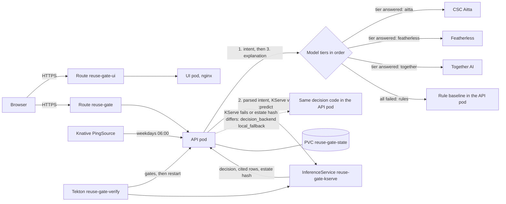

# Reuse Gate on Red Hat OpenShift AI

Reuse Gate answers Bayer's problem statement: "Enterprise self-service BI creates speed, but also dashboard sprawl, duplicate
logic, unclear ownership and technical debt." Before anyone builds a new dashboard, it recommends whether to reuse, repair,
extend, migrate, retire or build new, cites the rows of the estate it used, and lets a person approve. On the 150 business
requests in the SinceAI data pack, 57 avoid a new build. That is the platform's business value in Bayer's words: "fewer, better,
maintainable and governed analytics products", with "ownership, KPI consistency, human oversight and lifecycle control".

This page is exact about what runs where. "Live" means running in project `ztothez-dev` on the Developer Sandbox on
2026-11-07. "After rollout" means applied by `deploy/openshift/rollout.sh`, which has not been run yet.

## 1. What runs where

| Component | Runs on OpenShift | Why |
| --- | --- | --- |
| UI (`reuse-gate-ui`, static React build on UBI nginx, non-root) | Yes, live | Deployment, Service and edge Route `reuse-gate-ui` |
| API (`reuse-gate`, Python standard library) | Yes, live | Deployment, Service and edge Route `reuse-gate`. Live image `e7eccf8b5e28`, which predates this page's changes |
| Decision service `reuse-gate-kserve` | Yes, live | KServe InferenceService (raw deployment) on the ServingRuntime `reuse-gate-decision-runtime`, KServe v1 protocol. The "model" is the deterministic decision logic and the data pack in the image |
| API decisions through KServe (`REUSE_GATE_DECISION_BACKEND=kserve`) | After rollout | Live, the API decides in its own pod and does not call KServe. `api.yaml` turns the KServe path on |
| BuildConfigs `reuse-gate`, `reuse-gate-ui` | Yes, live | Binary Docker builds from a clean `git archive` export |
| Tekton pipeline `reuse-gate-verify` | Yes, live with 3 tasks; 5 tasks after rollout | Unit tests, governance gate and rollout are live (2 successful runs). Evaluation and security gates are added by the rollout |
| Knative PingSource `reuse-gate-radar-ping` | Yes, live | Calls `/radar-ping` at 06:00 on weekdays (Europe/Helsinki). A scheduled run has not been observed yet |
| PVC `reuse-gate-state` (1Gi, gp3) | After rollout | Work items, the decision log and the model and audio caches |
| In-cluster language model | No | Tried on the vLLM CPU runtime and rejected, see section 6 |
| CSC Aitta (`openai/gpt-oss-120b`, embeddings) | No, external (Finland) | Default first model tier. Returned HTTP 503 during this work |
| Featherless (`zai-org/GLM-5.2`) | No, external | Default second model tier |
| Together AI (`openai/gpt-oss-120b`) | No, external (US) | Optional tier while Aitta is down. Off unless `REUSE_GATE_LLM_TIERS` names it |
| ElevenLabs (speech to text and text to speech) | No, external | Listen button and voice input |
| n8n (approval webhook, radar digest) | No | Ran on a local throwaway instance only |

## 2. Architecture

Every response says which path it took: `decision_backend` is `kserve`, `local` or `local_fallback` (with
`decision_backend_reason`), `ai.tier` names the model tier that read the intent (`aitta`, `featherless`, `together`, `saved` or
`rules`), `ai.explanation_tier` the one that wrote the explanation, and `ai.tiers_failed` lists each tier that failed and why.

## 3. Portability to OpenShift AI

The decision engine and the KServe endpoint run on OpenShift today, while the language models are external providers in the demo.
Moving a model tier into the cluster needs configuration, not code:

1. Deploy a model on OpenShift AI with a vLLM ServingRuntime (CUDA on a GPU node for a model of useful size; the CPU runtime was
   too slow here, see section 6). Example: `deploy/openshift/llm-trial.yaml` with a larger `storageUri`.
2. Point a tier at it in the API Deployment:
   `REUSE_GATE_LLM_TIERS=incluster,aitta,featherless`, `REUSE_GATE_LLM_INCLUSTER_BASE_URL=http://<isvc>-predictor.<ns>.svc.cluster.local/v1`,
   `REUSE_GATE_LLM_INCLUSTER_MODEL=<served model name>`, optional `REUSE_GATE_LLM_INCLUSTER_TIMEOUT_S`.
3. To keep all text in the cluster, list only `incluster` and add an egress NetworkPolicy. The rules still answer if it fails.
4. Embeddings for KPI matching use Aitta's `intfloat/multilingual-e5-large`. In-cluster, serve an embedding model the same way and
   change `kpi_match.embedder_from_env` (today the one hard-coded provider).
5. The faithfulness guard, the deadline, the concurrency limit and the tier trail apply to every tier, in-cluster or not.

| Tier variable | Built-in default |
| --- | --- |
| `REUSE_GATE_LLM_TIERS` | `aitta,featherless` |
| `REUSE_GATE_LLM_<TIER>_BASE_URL`, `_MODEL`, `_API_KEY`, `_TIMEOUT_S` | `aitta`: Aitta URL, `openai/gpt-oss-120b`, `AITTA_API_KEY`, 20 s. `featherless`: Featherless URL, `zai-org/GLM-5.2`, `FEATHERLESS_API_KEY`, 40 s. `together`: `TOGETHER_BASE_URL` or `https://api.together.xyz/v1`, `TOGETHER_MODEL` or `openai/gpt-oss-120b`, `TOGETHER_API_KEY`, 20 s |

Secret key names: `reuse-gate-llm` holds `AITTA_API_KEY`, `FEATHERLESS_API_KEY` and `TOGETHER_API_KEY`; `reuse-gate-elevenlabs`
holds `ELEVENLABS_API_KEY`; `reuse-gate-n8n` holds `N8N_API_KEY`; `reuse-gate-access` holds `REUSE_GATE_WRITE_TOKEN`. Placeholders
only in `deploy/openshift/secrets.template.yaml`.

## 4. Data flow: what leaves the cluster

| To | What | When |
| --- | --- | --- |
| CSC Aitta, Featherless or Together AI (whichever tier answers) | Request text (at most 2000 characters) and the allow-listed product, market and KPI names; then the decision brief: action, target asset record including the **owner name**, KPI coverage, rationale, up to 15 citations, up to 5 retire or consolidate items; question wording | Each new request that is not a saved example. Together is a US provider and an outage fallback, not a sovereignty option |
| CSC Aitta | KPI phrases for embeddings | When no KPI was read |
| ElevenLabs | The spoken script (decision and explanation, at most 1000 characters); voice recordings (at most 1 MB) | Listen and voice input only |
| Nothing | Keys, the decision log, work items, approver names, clarification answers, the database | Never |

The KServe call stays inside the project (`allow-same-namespace` NetworkPolicy). Details: `docs/security.md`.

## 5. Reliability on the platform

- **Probes:** API readiness and liveness on `/healthz` (3 s timeout). `/healthz` always answers 200 while the process serves and
  reports the decision backend and whether KServe answers (checked at most every 30 seconds), so a KServe outage never restarts the API.
  The decision predictor has readiness on `/v1/models/reuse-gate-kserve` and liveness on `/healthz`. The UI probes `/`.
- **Resources:** API 50m and 128Mi requested, 500m and 512Mi limit; predictor the same; UI 10m and 32Mi, 100m and 128Mi. Quota
  in this project: 3 CPU and 30Gi requested in total, no GPU. All three use about 0.2 CPU of it.
- **Security context:** non-root, no privilege escalation, all capabilities dropped, `RuntimeDefault` seccomp. The API root
  filesystem is read-only; it writes only to the state volume and `/tmp`. The UI's is writable because nginx writes temp files.
- **Secrets:** every key comes from a Secret through optional references; without a model key the API runs on the rules and says so.
  No key is in an image, a manifest or the repository (secret scan: 0 findings).
- **State:** `REUSE_GATE_STATE_DIR=/var/lib/reuse-gate` on the PVC `reuse-gate-state` (ReadWriteOnce, so the Deployment uses
  `Recreate`). The decision log and work items are read back at startup, and the 10 samples are seeded only on an empty volume. A
  missing or read-only directory never stops startup: the API keeps state in memory and logs it. Tested with a real process
  restarted on the same directory and with a read-only directory.
- **Decision path:** in `kserve` mode a 5 second timeout, then the same decision in the API pod, recorded as `local_fallback`.
  The predictor returns the hash of its `estate.db`; a different hash is refused (`estate_mismatch`). Parity is tested: identical
  decisions in both modes on the 21 messy prompts through every clarification round and on the 10 distinct request texts.
- **Pipeline gates** (`reuse-gate-verify`, each runs inside the built image):
  1. `unit-tests`: the backend suite (346 tests locally; tests needing repo-only files skip themselves).
  2. `governance-gate`: every recommendation has an action, a rationale and cited rows.
  3. `evaluation-gate`: `scripts/check_evaluation.py`, fresh offline and on the shipped `data/evaluation.json`. Minimums:
     deterministic faithfulness 1.0, guard replacement rate at most 0.10, citation validity 1.0, context precision at least
     0.90, context recall at least 0.95, LLM judge at least 0.80 when it ran. Current: 1.0, 0.0, 1.0, 0.937, 0.992, not run.
  4. `security-gate`: security unit tests, then `scripts/security_check.py` against the API started in the task with throwaway
     token and n8n values: 19 of 19 locally.
  5. `rollout`: restarts the API and the predictor and waits for both.
- **12-hour recycling:** the Sandbox recycles or idles pods. State is on the PVC, the samples reseed only when empty, and
  `deploy/openshift/wake.sh` scales back anything at 0, waits for UI, API and predictor, checks the InferenceService, the routes and
  `/healthz`, warms every model tier and prints GREEN, AMBER or RED per part. Run it before every demo; it is safe to repeat.
- **Image contents** (Containerfile COPY lines): runtime files `data/estate.db`, `data/catalog.json`, `data/prewarmed_answers.json`,
  `data/evaluation.json` (for `GET /evaluation`, missing from the live image); gate files `data/messy_requests.jsonl`,
  `data/judge_prompt.txt`, `data/gold_labels_template.csv`, `data/cases.example.jsonl`, `data/mock_api.json`,
  `docs/eval_report.json`. Work item samples are built from `estate.db`. Checked by running the API and both gates from a read-only
  copy of exactly these files (no container builder on the build machine).

## 6. Known limits

- **Not rolled out.** Everything marked "after rollout" is validated with `oc apply --dry-run=server`, unit tests and local runs,
  not on the cluster. The live API is the older image without `/healthz`, the KServe path, the state volume or the new gates.
- **In-cluster model tier: no-go.** On the vLLM CPU (x86) runtime with 2 CPU requested and 4 CPU limit:
  `Qwen2.5-0.5B-Instruct` started in 174 s and answered intent calls in 8.7 to 16.0 s (median 13.8 s), but 0 of 21 messy
  prompts gave a usable intent: it returned every product and KPI from the allow-lists and no `kind`. Those values are all
  allowed, so the pipeline took them as an AI intent and recommended `new_build` for all 10 request texts; the faithfulness guard
  passed every explanation because it checks facts, not the intent. `Qwen2.5-1.5B-Instruct` started in 233 s, generated about
  7.5 tokens per second, took 15.2 to 26.5 s per call (median 19.6 s) on 6 calls, timed out at 60 s on the 7th, and gave 4 of 7
  schema-valid answers with 0 usable intents. A model swap also needs delete and recreate, because a rolling update needs two
  2-CPU pods and the quota allows 3 CPU requested. The trial service was deleted. Raw numbers: `docs/llm_trial_measurements.json`.
- **Weak models can pass the allow-list.** An intent made only of allowed values is accepted. A tier that echoes the lists
  produces wrong but well-formed intents. Production should reject an intent that names every product or most KPIs.
- **No GPU** in the Sandbox, so a useful in-cluster model is not measurable here.
- **Dashboard view not verified.** The InferenceService now uses a named ServingRuntime with display names and is `Ready`;
  how the OpenShift AI Deployments page shows it was not checked in a browser. No hardware profile is set: the project cannot
  list hardware profiles.
- **Single replica.** The state volume is ReadWriteOnce, rate limits are per process, and a restart is a short outage (`Recreate`).
- **Rate limits rely on the router** appending the client address to `X-Forwarded-For`; not confirmed on this cluster.
- **Access:** no login. The write token guards `/approve` and `/remediate` only; anyone with the URL can create work items.
- **Embeddings** are always on Aitta, so KPI matching is off while Aitta is down.
- **The PingSource's scheduled run** has not been observed; manual calls to `/radar-ping` work.
- **External providers** have no SLA here. Aitta answered HTTP 503 during this work; Featherless answered.

## 7. Red Hat evidence

UI: https://reuse-gate-ui-ztothez-dev.apps.rm1.0a51.p1.openshiftapps.com

Description for the award form:

> Reuse Gate runs on Red Hat OpenShift: a static UI and a Python API, each built by a BuildConfig from a clean git export and
> served through edge Routes, plus a KServe InferenceService (reuse-gate-kserve) on a custom ServingRuntime that serves the
> deterministic reuse, repair, extend, migrate or retire decision with cited evidence over the KServe v1 protocol. A Tekton
> pipeline runs unit tests, a governance gate, an evaluation gate and a security gate on each image before rolling it out, and a
> Knative PingSource triggers the weekday governance radar digest. The language models are external OpenAI-compatible providers,
> configured as tiers that can be moved to an OpenShift AI vLLM endpoint by environment variables alone.

The evaluation and security gates are in the pipeline after the rollout; until then the live pipeline has three tasks.

## 8. Console demo shot list (30 to 45 seconds)

Record after `rollout.sh` and `wake.sh`, so the pipeline run with all gates exists and the API is in `kserve` mode.

| # | Shot | Seconds | Narration |
| --- | --- | --- | --- |
| 1 | OpenShift AI, Deployments page, expand `reuse-gate-kserve` | 7 | Our decision engine is served by OpenShift AI as a KServe inference service, on its own serving runtime. |
| 2 | Developer console, Topology: UI, API, predictor, PingSource | 6 | The interface, the API and the decision service each run as separate workloads in one project. |
| 3 | Builds: `reuse-gate` and `reuse-gate-ui` | 5 | Every image is built in the cluster from a clean export of the repository. |
| 4 | Pipelines: the latest `reuse-gate-verify` run, all five tasks green | 8 | Before anything ships, the pipeline runs the tests, a governance gate, an evaluation gate and a security gate. |
| 5 | PingSource `reuse-gate-radar-ping` | 5 | Every weekday morning, a Knative ping triggers the governance radar, without anyone asking. |
| 6 | The UI: submit a request; then the browser's Network tab (the UI does not display these fields) with the `/recommend` response open at `decision_backend: kserve` and `ai.tier` | 10 | A live request is decided by the KServe service, with every cited row, and shows which model tier wrote the explanation. |
